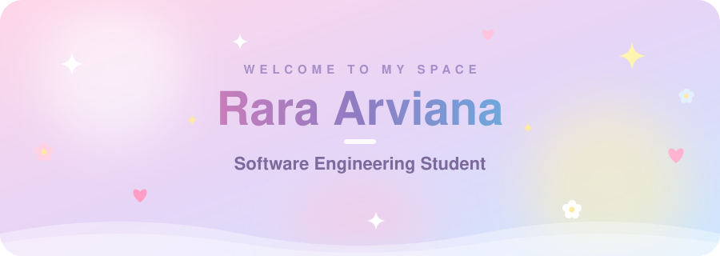

 

  

 

<h2>🌸 About Me</h2>

My name is Rara Arviana, a Software Engineering student at Taruna Bhakti Vocational School, Depok, specializing in web and mobile development.

Passionate about front-end development and building user-friendly applications using JavaScript, Node.js, Express.js, Tailwind CSS, React Native, and MySQL.

Committed to continuous learning and quickly adapting new technologies to improve code quality and user experience.

<h2>🫧 Tech Stack</h2>

<h3>🌷 Languages and Web</h3>

<h3>🔮 Frontend</h3>

<h3>☁️ Backend</h3>

<h3>🍃 Database</h3>

<h3>🎀 Design</h3>

<h3>🍋 Tools and Deployment</h3>

  

<h2>🍓 GitHub Stats</h2>

  

  

 

made with 🩷 by Rara Arviana

